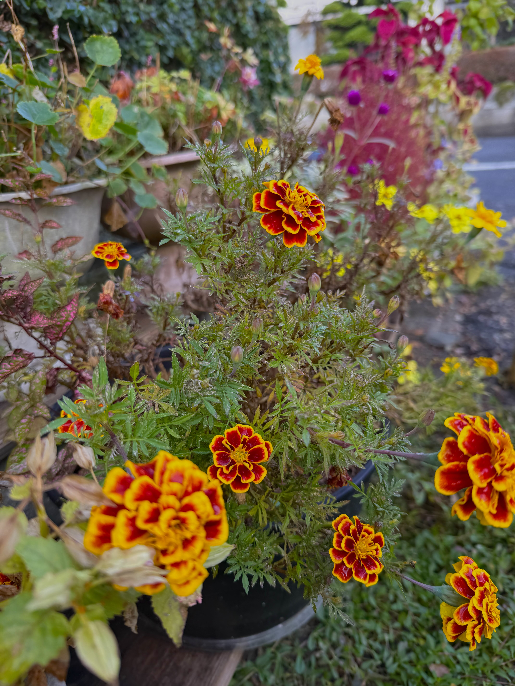
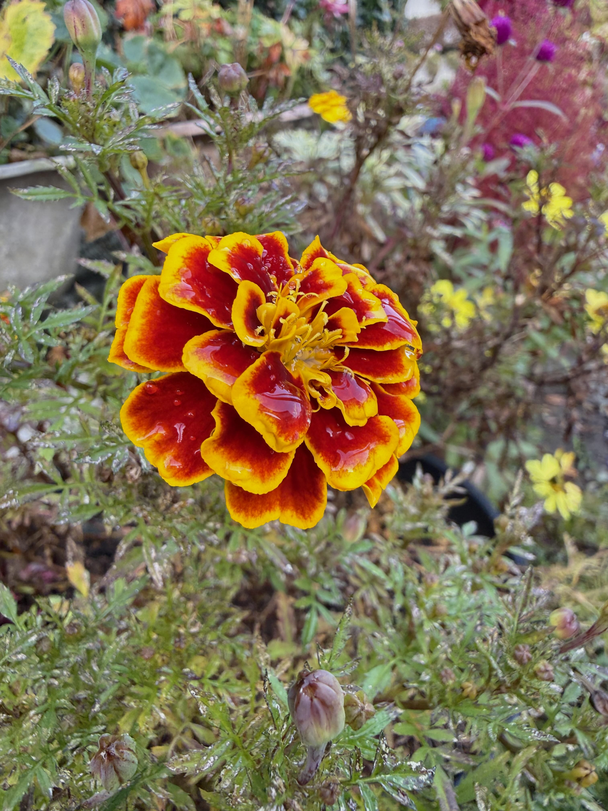
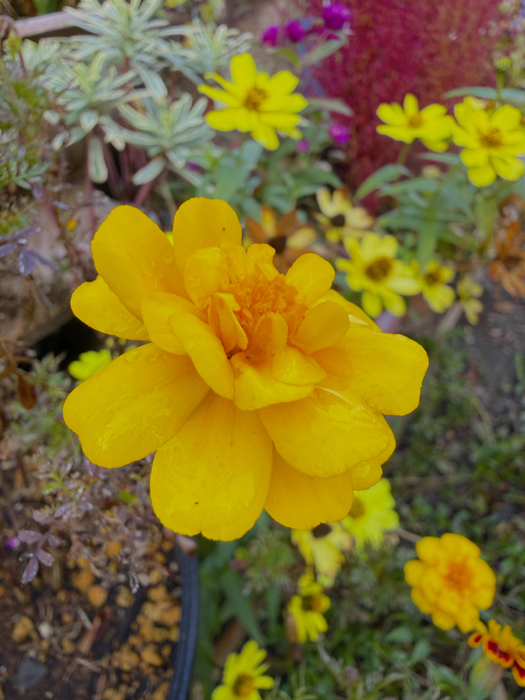
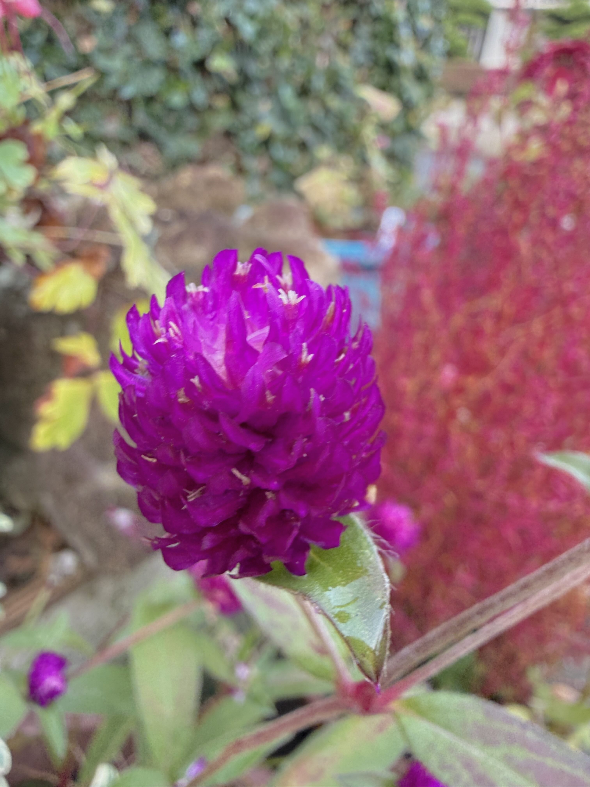
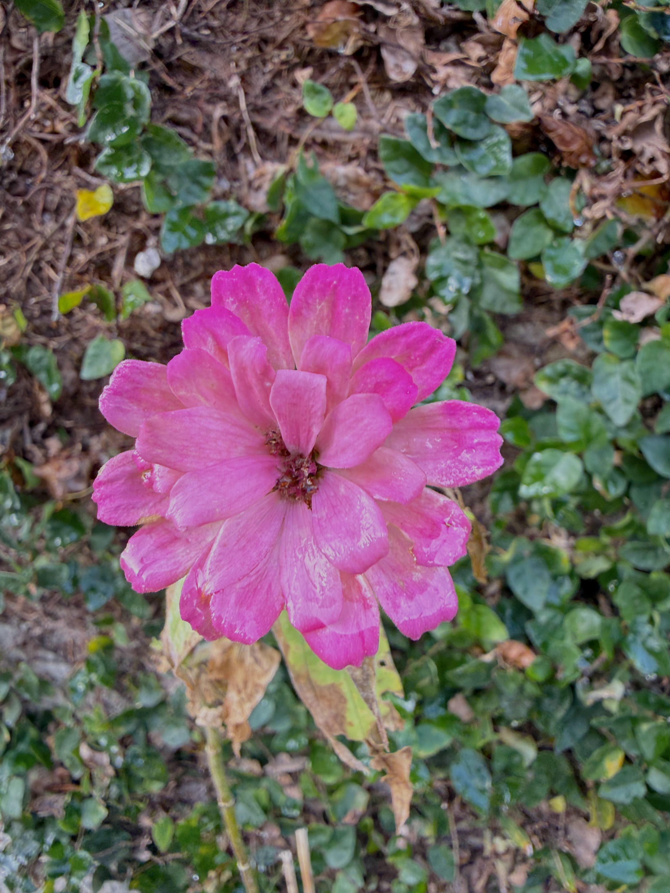
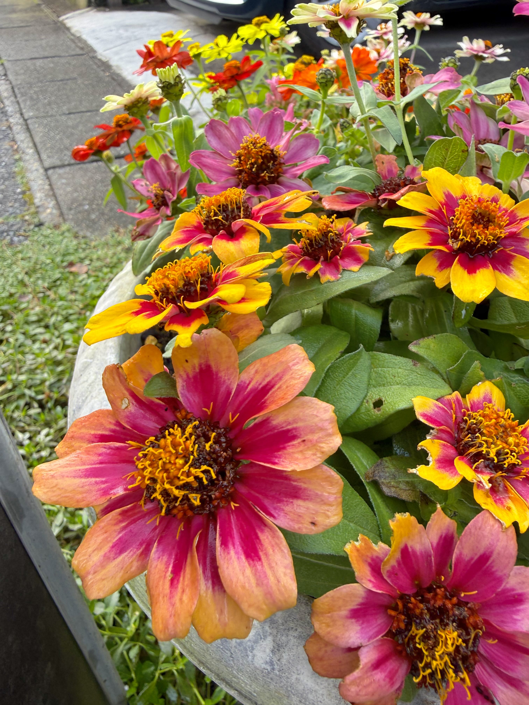
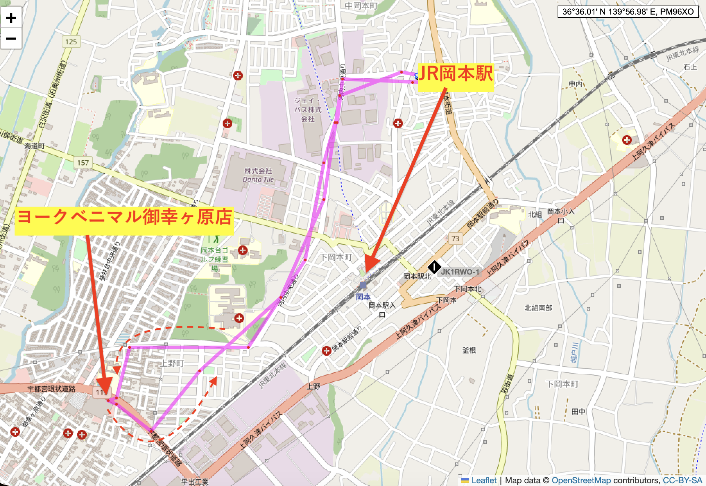

# 20261022_utsunomiya
<html lang="ja" data-loaded="false" data-scrolled="false" data-spmenu="closed">
<head>

<meta charset="UTF-8">
<meta http-equiv="Content-Type" content="text/html; charset=UTF-8">
<meta http-equiv="X-UA-Compatible" content="IE=EmulateIE10" />
<meta http-equiv="X-UA-Compatible" content="IE=edge">

<meta name="viewport" content="width=device-width, initial-scale=1.0">

<!--ここから上はお決まりの定型文です-->

<!--ここからが表現の書式などを決めるcssという部分-->

<link href="https://cdnjs.cloudflare.com/ajax/libs/lightbox2/2.7.1/css/lightbox.css" rel="stylesheet">

</head>

<body>

<!-- オープニング（スプラッシュ画面に写真とタイトルを配置） -->

  

    
    
最初の一枚は一輪の薔薇

  

<!-- メインコンテンツ -->

  <h1>メインのホームページ画像</h1>
  

<!--
    
<a href="https://peyng.github.io/restart/">前回までの記録</a>><a>今回2026,05,28</a>

-->

モバイル端末をお使いの場合は、画面を横向きにすると
背景画像の横方向がご覧頂けます。

<!--ここ上は、ほぼそのまま使います！-->

<!--QRコードの挿入例-->

 QR for Access

<marquee direction="left" scrollamount="20" width="30%">(^_^)/~alis</marquee>

<!--流れ文字の挿入例-->
<h1><marquee behavior="left">!!! 2026/10/22、ご近所のお花達から、夕空のお月様と飛行機雲まで !!!</marquee></h1>

                          

<!--ここから下が、本体部分-->

<h2>2026Oct21、ご近所のお花達は手入れが行き届いて綺麗に満開</h2>

<h2>オープニング画像になった一輪の薔薇</h2>

<h2>本日の背景はこちらのシクラメン</h2>

<h2>お昼はスーパーのお弁当でした</h2>

<h2>デザートはフライドポテト</h2>

<h2>庭に来た野鳥と目があって、網戸越しにパチリ！</h2>

<h2>夕方の空にお月様が浮かびました</h2>

<h2>月齢は、9.9日、うさぎさんも見えています</h2>

<h2>薔薇の蕾も控えています</h2>

<h2>サルビアもまだまだ元気</h2>

<h2>青空に飛行機雲が綺麗でした</h2>

<h2>宇都宮市北部、ヨークベニマル御幸ヶ原店までの走行経路はこのルート</h2>

<h2>ヨークベニマル御幸ヶ原店までの行き帰り運転動画</h2>

<iframe width="560" height="315" src="https://www.youtube.com/embed/-Wua99x_vac?si=UUJzB1QLhTCnXvD_&autoplay=1&mute=1&loop=1&playlist=-Wua99x_vac" title="YouTube video player" frameborder="0" allow="accelerometer; autoplay; clipboard-write; encrypted-media; gyroscope; picture-in-picture" allowfullscreen></iframe>
    

<h2>以上、今回は、ご近所のお花達がメインでした</h2>

  
<h2>月齢の説明リンク貼ります</h2>
<h2><a href="https://starwalk.space/ja/moon-calendar" target="_blank">月齢カレンダー・リンク</a></h2>

  
  

<h2>今日のBGMは、Koji Tamaki, Miyuki Nakajima, Shogo Hamada & Kazumasa Oda | 心に響く日本の名曲 Timeless Japanese Hits</h2>

<iframe width="560" height="315" src="https://www.youtube.com/embed/IO9O0n0Wi3Q?si=g6LZbyt-2EO5yUBp&autoplay=1&mute=0&loop=1&playlist=IO9O0n0Wi3Q" title="YouTube video player" frameborder="0" allow="accelerometer; autoplay; clipboard-write; encrypted-media; gyroscope; picture-in-picture" allowfullscreen></iframe>
    

   
<h2>2026Oct22、ご近所のお花達から、夕空のお月様と飛行機雲まででした Thank you for reading this far.</h2>

   

<!-- hitwebcounter Code START -->
<a href="https://www.hitwebcounter.com" target="_blank">

you are visitor The numbers are cumulative for the Bangkok ＆ Utsunomiya series websites launched since 2025 August 1st.
</a>  

         

  

      

<!--本体はここまで-->
    

<!--画面に空白地帯を作って、背景が見えるようにしています-->
                                              

<!-- フッタ -->
<footer>

Copyright 2026/10/22 alis

</footer>

<!--HPにさまざまなJavaScriptを呼び込むための書式-->

    </body>
    
</html>
